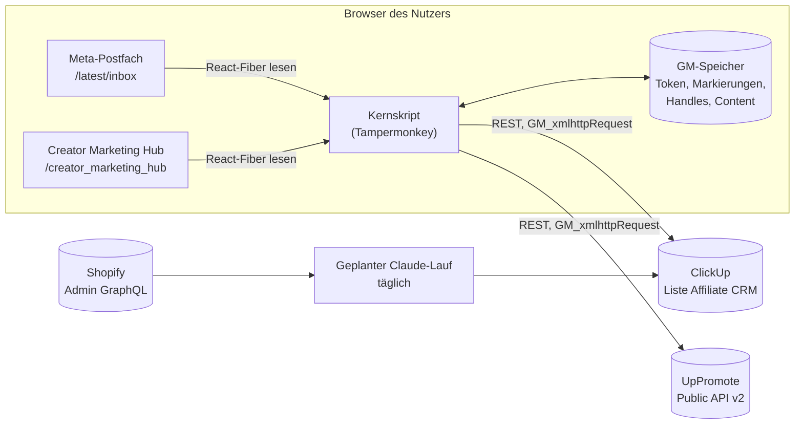
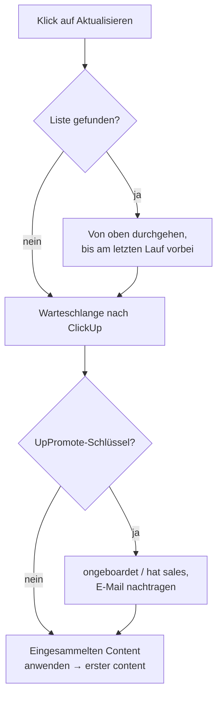

# Entwicklerdokumentation

Wie die Teile zusammenhängen, warum sie so gebaut sind, und wie man die
Umgebung aufsetzt.

Die Bedienung steht in [bedienung.md](bedienung.md).

---

## 1. Was das Ganze ist

Zwei Tampermonkey-Userscripts, die in der Meta Business Suite laufen und eine
Affiliate-Pipeline in ClickUp pflegen. Kein Server, keine Datenbank, keine
Erweiterung — alles passiert im Browser des Nutzers.

| Datei | Zweck |
|---|---|
| `postfach-markierungen.user.js` | Das Kernskript. Markierungen im Postfach, ClickUp-Anbindung, UpPromote, Content-Auswertung. |
| `creator-marketplace-links.user.js` | Blendet im Creator Marketplace eine Pille „zum Insta-Profil" ein. Eigenständig, kennt ClickUp nicht. |
| `postfach-lader.user.js` | **Zurückgestellt, nicht installieren.** Siehe Abschnitt 9. |

---

## 2. Verdrahtung



Der entscheidende Punkt: **Shopify hängt bewusst nicht am Skript.** Ein
Shopify-Admin-Token im Browser läse den kompletten Kundenstamm. Stattdessen
holt ein geplanter Claude-Lauf die Daten und schreibt sie nach ClickUp, mit
Zugängen, die ohnehin außerhalb des Browsers liegen.

---

## 3. Woher welches Signal kommt

| Signal | Quelle | Feld / Merkmal | Wer holt es |
|---|---|---|---|
| Unterhaltung, Titel, Datum | Meta-Postfach | React-Fiber, `thread` | Kernskript |
| Wer zuletzt schrieb | Meta-Postfach | Snippet beginnt mit `Du: ` | Kernskript |
| Instagram-Handle | Marketplace, Kontaktkarte, Vorschautext | Text | Kernskript |
| Onboarding | UpPromote | `GET /affiliates?status=active` | Kernskript |
| Sales | UpPromote | `approved_ + pending_ + paid_amount` | Kernskript |
| E-Mail des Affiliates | UpPromote | `email` | Kernskript |
| Nutzbarer Content | Creator Marketing Hub | React-Fiber, `content.ad_ready_status` | Kernskript |
| Warensendung | Shopify | Bestellung mit Tag `uppromote_gift` **oder** `Affiliate`, 0,00 € | Geplanter Lauf |
| Nachfass-Frist | abgeleitet | spätere aus „letzte Nachricht + 14 Tage" und „Versand + 10 Wochentage" | Skript, ersatzweise geplanter Lauf |
| Tag `ad-code` | Creator Marketing Hub | einmal nutzbarer Content gesehen | Skript |

### UpPromote

Basis `https://aff-api.uppromote.com/api/v2`, Schlüssel im Header
`Authorization`. 120 Anfragen pro Minute und Shop.

Es gibt **keinen Gifts-Endpunkt** — die Bereiche sind Programs, Affiliates,
Coupons, Payments, Referrals, Analytics, Webhooks. Warensendungen sind deshalb
nur über Shopify zu bekommen.

`upAktive()` blättert mit `per_page=100&page=N` und bricht ab, sobald eine Seite
dieselben Einträge liefert wie die vorige. Ohne diese Schranke lief die
Schleife bis zum Seitenlimit, falls UpPromote `page` ignoriert — einmal über
sechs Minuten ohne jedes Lebenszeichen.

### Creator Marketing Hub

Seite `/creator_marketing_hub/ad_content/`. Jede Kachel trägt am React-Fiber
ein `content`-Objekt. **Maßgeblich ist `ad_ready_status`, nicht
`pa_content_type`** — Berechtigung und Content-Art sind unabhängige Achsen, es
gibt UGC mit Rechten und Branded Content ohne.

| Metas Filter | `ad_ready_status` | Bedeutung |
|---|---|---|
| Für Anzeige bereit | `NO_ISSUES` | Rechte liegen vor |
| Handeln erforderlich | `WARNINGS` | keine Berechtigung, aber anfragbar |
| Unzulässig | nie beobachtet | nicht nutzbar |

Gezählt wird als **Positivliste** (`NO_ISSUES` oder `WARNINGS`), damit der
dritte Wert nie versehentlich mitzählt.

Zwei Parameter gehören zwingend in die Adresse:

- `sort_index=upac_publish_time` — ohne Datumssortierung zeigt Meta nach
  Relevanz vor allem fremde Creator
- `business_id` und `asset_id` — ohne sie landet Meta auf dem zuletzt
  benutzten Konto. Das Skript übernimmt beide aus der Adresse des Postfachs,
  statt sie fest zu verdrahten.

### Shopify

Warensendungen sehen in Shopify auf **zwei** Arten aus, je nach Zeitraum:

| Zeitraum | Tag | Entstehung |
|---|---|---|
| seit 06.08.2026 | `uppromote_gift` | UpPromote legt sie an, wenn der Affiliate sein Geschenk einlöst |
| davor, ca. 08.05.–02.09.2026 | `Affiliate` | von Hand als Entwurfsbestellung erfasst |

Beide haben Gesamtwert 0,00 €.

```graphql
orders(query: "tag:uppromote_gift OR tag:Affiliate") {
  name  createdAt  email  tags  displayFulfillmentStatus
  totalPriceSet { shopMoney { amount } }
}
```

Behalten wird nur, was **0,00 €** kostet und auf `FULFILLED` oder
`PARTIALLY_FULFILLED` steht — nur das ist wirklich raus. Bei mehreren
Bestellungen zu einer Adresse zählt die älteste. Zugeordnet wird
**ausschließlich über exakte E-Mail-Übereinstimmung**, nie über
Namensähnlichkeit.

#### Nachfass-Frist

Das Fälligkeitsdatum des Tasks ist die Deadline zum Nachhaken. Es gelten zwei
Regeln, und zwar **die spätere von beiden**:

- **14 Tage nach der letzten Nachricht oder Reaktion des Creators**
- **10 Wochentage nach dem Versand der Ware**, falls es einen gibt — gezählt ab
  dem Tag nach dem Versand, Samstag und Sonntag übersprungen, Feiertage
  unberücksichtigt

Kontrollbeispiel: Versand Freitag 31.07.2026 → Frist Freitag 14.08.2026.

> **Warum „die spätere" nicht nur sinnvoll, sondern nötig ist.**
> Das `start_date` trägt bei uns das Datum der letzten Nachricht, und **ClickUp
> lehnt ein Startdatum nach dem Fälligkeitsdatum ab** („Start date cannot be
> after due date"). Eine reine Versandfrist lag bei laufenden Unterhaltungen
> irgendwann vor der letzten Nachricht — ab da scheiterte jedes weitere
> Schreiben mit Fehler 400, und weil sich das Skript das Datum erst nach
> erfolgreichem Schreiben merkt, stellte es den Auftrag bei jedem Durchlauf
> neu ein. Dauerschleife.
>
> Die 14-Tage-Regel schließt das von selbst aus: eine Frist 14 Tage nach der
> letzten Nachricht liegt nie davor. Zusätzlich gehen Startdatum und Frist in
> **einer** Anfrage raus, nie einzeln.
>
> Die „Duration ClickApp", die ClickUp in der Fehlermeldung vorschlägt, wäre
> der falsche Weg: sie würde eines der beiden Daten selbsttätig verschieben und
> damit genau die Bedeutung zerstören, die wir hineinlegen.

Zuständig ist in erster Linie das Skript — es sieht bei jedem Durchlauf jede
sichtbare Unterhaltung. Der geplante Shopify-Lauf setzt eine Frist nur, wenn
noch gar keine da ist, für Tasks, deren Unterhaltung das Skript nicht zu
Gesicht bekommen hat. Ein von Hand gesetztes Datum bleibt in beiden Fällen
unangetastet.

#### Kein neuer Task ohne Handle

Weil ein Task ohne Handle für jede Automatik unsichtbar ist, wird der Handle
beim Anlegen aktiv beschafft — in drei Stufen.

**Stufe 1, Kontaktkarte.** Markiert jemand eine Unterhaltung, zu der kein
Handle bekannt ist, öffnet das Skript sie und liest die Kontaktkarte aus. Das
ist die einzige zweifelsfreie Quelle: dort steht das Profil der Person, mit der
tatsächlich geschrieben wird. Bis zu fünf Sekunden wird gewartet, dann gibt es
auf.

**Stufe 2, Nachfrage.** Gibt die Karte nichts her — es gibt nicht zu jeder
Unterhaltung eine —, erscheint ein Kasten mit Eingabefeld, einem Link nach
Instagram und dem Ausgang „Später nachtragen".

**Stufe 3, Werkbank.** Im Panel listet der Abschnitt „Handles nachtragen" alle
Tasks ohne Handle, jeweils mit Eingabefeld. An der Pille steht zusätzlich
„N ohne Handle".

> **Warum nicht einfach das Anlegen verweigern?**
> Weil die Markierung dann trotzdem bestünde — nur noch lokal im Browser. Der
> Datensatz wäre nicht mehr in ClickUp unvollständig, sondern für Cosima
> überhaupt nicht vorhanden. Das Anlegen läuft deshalb immer durch; der Handle
> kommt nach.

**Einwortige Namen gelten nur klein geschrieben als Handle.** `stadtpedal` und
`hansj.stolz` sind Handles, `Timo` und `Sophie` sind Vornamen. Ohne diese
Schranke hielt `handleAusTaskname` jeden einwortigen Anzeigenamen für einen
Handle, machte daraus kleingeschrieben einen Suchschlüssel und nahm solche
Tasks aus der Lücken-Erkennung heraus — sie galten als versorgt, obwohl der
Handle geraten war.

#### Der Tag `ad-code`

Sobald zu einem Creator zum ersten Mal nutzbarer Content gesehen wurde, bekommt
sein Task den Tag **`ad-code`**. Anders als der Status bleibt er stehen, auch
wenn der Task weiterwandert — er hält eine Tatsache fest, keinen Zustand. Es
gibt deshalb kein Entfernen, und er wird auch dann gesetzt, wenn der Status
wegen der Leiter nicht mehr geändert wird.

> Die erste Fassung suchte nur nach `uppromote_gift` und übersah damit über
> hundert Altfälle aus der Handarbeits-Zeit — aufgefallen an einem Affiliate,
> dessen Paket nachweislich raus war und der trotzdem auf `ongeboardet` stand.
> Beim Erweitern solcher Filter lohnt die Gegenprobe ohne Filter.

---

### Affiliates aus UpPromote importieren

Knopf „Affiliates importieren" im Panel. Holt alle **aktiven** Affiliates des
Programms `TZAMPAS Affiliate Programm` und legt die an, die noch fehlen.

**Erster Klick zählt nur**, zweiter legt an. Bei über hundert Datensätzen will
man vorher sehen, was passiert. Die Vorschau verfällt nach fünf Minuten.

Als „schon vorhanden" gilt, wer über **Handle oder E-Mail** zu einem
bestehenden Task passt. Tasks ohne Handle und ohne `igfu-mail` sind damit nicht
erkennbar — die würden doppelt angelegt. Vor einem Import also erst die Lücken
füllen.

Neue Tasks bekommen Titel `handle — Name`, Status nach der Leiter
(`ongeboardet`, bei Provision `hat sales`), die Instagram-Zeile und die Marker
`igfu-handle` und `igfu-mail`. Ohne Handle zusätzlich den Tag `handle-fehlt`.

**Der Unterhaltungs-Link lässt sich nicht aus dem Handle bauen.**
`selected_item_id` ist Metas interne, 39-stellige Unterhaltungs-ID; der Handle
kommt darin nicht vor und es gibt keine Rechenvorschrift. Der Link kann nur
gesetzt werden, wenn das Skript die Unterhaltung schon einmal gesehen hat —
`threadZuHandle()` schlägt im GM-Speicher nach. Viele Affiliates wurden nie
über das Partner-Postfach angeworben und haben schlicht keine.

### Notizen aus UpPromote

Zwei Felder am Affiliate werden als **ClickUp-Kommentar** übernommen, getrennt
beschriftet:

- `internal_note` — was ihr über den Affiliate notiert habt
- `personal_detail` — was der Affiliate selbst angegeben hat

Das passiert im UpPromote-Abgleich, also für **alle** passenden Tasks, nicht
nur für frisch importierte.

**Gegen Doppelungen** steht eine Kurzprüfsumme der Notiz als Markerzeile
`igfu-notiz` in der Beschreibung — bewusst dort und nicht im GM-Speicher, denn
der ist pro Browser: sonst postet der Mac, was Windows schon gepostet hat.
Ändert sich die Notiz, ändert sich die Prüfsumme und es kommt ein **neuer**
Kommentar dazu; der alte bleibt stehen, weil ein Verlauf hier nützlicher ist
als stilles Überschreiben.

Die Sperre liegt doppelt: einmal als Filter in `upAbgleichen`, einmal in
`notizUebertragen`. Ein Mutationstest, der nur eine davon entfernt, bleibt
deshalb wirkungslos — erst wenn beide fallen, kommt der Kommentar zweimal.

### Nachträglich verbinden

Wird später doch eine Unterhaltung angefangen, taucht sie im Postfach auf.
`scanRows` erkennt den Handle und verbindet sie über den Auftrag
`verbinden-handle` mit dem vorhandenen Task: Link und `igfu-thread` werden
nachgetragen, der Task wandert von `cuOhneThread` nach `cuTasks`. Ohne Zutun.

Das Anschreiben selbst ist **bewusst nicht automatisiert** — Nachrichten im
Namen des Nutzers verschickt das Skript nicht.

## 3b. Die Unterhaltungsliste auf instagram.com

Die Kennung steht an `props.threadRef.thread_key` — genau die aus der Adresse
`/direct/t/<id>/`. **Sie ist aus der Liste lesbar, ohne eine Unterhaltung zu
öffnen.** Das ist die entscheidende Eigenschaft: Öffnen würde sie als gelesen
markieren.

Name, Vorschau, Zeit und Lesestatus stehen dagegen nicht in den Props, sondern
nur im Relay-Speicher. Gerendert liegen sie als Zeilen im Text der Zeile:

```
[0] Name          „stadtpedal"
[1] Vorschau      „You: …" | „Liked a message" | „3 new messages"
[2] Relativzeit   „10m" | „6h" | „3d" | „2w"
[3] „Unread"      nur wenn ungelesen
```

**Zwei Fallen, beide real aufgetreten:**

1. **Der eigene Knopfstreifen hängt als Kind in der Zeile.** Liest man den Text
   naiv aus, liest sich das Skript seine eigene Beschriftung ein — und
   „Ungelesen" auf einem Chip wird zu Metas Lesestatus. Aus einer bloßen
   Reaktion wurde so eine offene Nachricht. `zeilenText()` überspringt
   `.igfu-tags` deshalb ausdrücklich.
2. **Instagram nennt nur den Abstand, nie den Zeitpunkt.** `igZeitpunkt()`
   rechnet „10m" und „3d" in einen Zeitpunkt zurück. Für eine Frist von 14 Tagen
   reicht Tagesgenauigkeit.

Bei ungelesenen Unterhaltungen ersetzt Instagram die Vorschau durch
„N new messages" und verschluckt damit den Text. Macht nichts: ungelesen heißt
ohnehin, dass das Gegenüber zuletzt geschrieben hat, und genau so wertet
`werZuletzt()` es aus.

Der Zeilentitel ist auf instagram.com häufig schon der Handle. Sieht er wie einer
aus — geprüft am **unveränderten** Titel —, wird er ohne Nachfrage übernommen.

---

### Der Status `ignore`

Seit dem 12.10.2026 gibt es in der Liste einen Status `ignore` (Typ „done") für
Profile, mit denen abgeschlossen ist. Er steht in `STATUS_ENDE` und ist damit
für die Statusleiter gesperrt — ohne diesen Eintrag hätte der UpPromote-Abgleich
solche Tasks beim nächsten Lauf wieder auf `hat sales` gezogen.

Nicht zu verwechseln mit dem **Tag** `ignore`, den das Skript bewusst nicht
auswertet. Der Status wirkt, das Tag nicht.

**Die Endstatus gelten an zwei Stellen, und beide müssen sie kennen:** im Skript
über `STATUS_ENDE`, und im geplanten Shopify-Lauf
(`~/.claude/scheduled-tasks/tzampas-warensendungen/SKILL.md`), der seine eigene
Statusleiter in Prosa mitbringt. Am 12.10.2026 kannte der Lauf `ignore` noch
nicht — eine Änderung an der Leiter muss immer dort mitgezogen werden.

### Keine eigene Ungelesen-Markierung mehr

Bis 6.0 trug jede Zeile einen eigenen „Ungelesen"-Knopf, dessen Zustand im
GM-Speicher unter `igfu:unread:v1` lag. **In 6.1 ist er entfallen**: Instagram
kann das selbst, und zwei Ungelesen-Zustände nebeneinander stiften nur
Verwirrung darüber, welcher gilt.

Der alte Schlüssel wird nicht mehr gelesen und auch **nicht gelöscht** — wer die
alten Markierungen noch braucht, findet sie in Tampermonkeys Speicher. Sicherungen
tragen jetzt `version: 3` und nur noch die Follow-ups; ältere Dateien mit
`unread` bleiben lesbar, das Feld wird übergangen.

---

## 4. Die Brücke zwischen den Welten

Jedes System kennt den Affiliate unter einem anderen Schlüssel:

```
Meta-Postfach ──── threadID
Marketplace ────── Bild-ID des Profilfotos
ClickUp ────────── Handle im Task-Namen  ("handle — Anzeigename")
UpPromote ──────── Handle  +  E-Mail
Shopify ────────── E-Mail
```

Verbunden wird über Markerzeilen in der **Task-Beschreibung**:

```
igfu-thread: <kennung>      Unterhaltung im Postfach der Business Suite
igfu-ig:     <kennung>      Unterhaltung auf instagram.com
igfu-iguser: <id>           Instagram-Benutzer-ID — der führende Schlüssel
igfu-handle: <handle>       Task ↔ UpPromote, Content, Marketplace
igfu-bild:   <bildID>       im Marketplace erfasster Task ↔ Unterhaltung
igfu-mail:   <adresse>      Task ↔ Shopify-Bestellung
igfu-ware:   <JJJJ-MM-TT>   Versanddatum, vom geplanten Lauf gesetzt
                            (das Skript liest es für die Frist mit)
```

**Der Handle steht an zwei Stellen, und das mit Absicht.** Im Task-Namen, weil
man ihn dort sieht und danach suchen kann. Und als Markerzeile, weil die die
**maßgebliche Bezugsstelle** ist: `handleVonTask()` liest erst den Marker, erst
dann den Namen. Eine Umbenennung in ClickUp kann die Zuordnung damit nicht mehr
stillschweigend zerreißen.

### Wie ein importierter Task seine Unterhaltung findet

Aus UpPromote importierte Tasks haben beim Anlegen keine `igfu-thread`-Zeile,
weil mit den meisten dieser Affiliates nie über das Partner-Postfach geschrieben
wurde. Verbunden wird nachträglich, und zwar über zwei Wege in dieser Reihenfolge:

```
Unterhaltung im Postfach
        │
        ├── Benutzer-ID?     ──ja──► Task mit gleichem igfu-iguser   (verbinden-handle)
        │   (props.threadRef
        │    .users[0].id)
        │
        ├── Handle bekannt?  ──ja──► Task mit gleichem igfu-handle   (verbinden-handle)
        │   (Vorschautext,
        │    Kontaktkarte)
        │
        └── nein ──► Anzeigename  ──► Task mit gleichem Namen        (Namensbrücke)
```

#### Warum die Benutzer-ID ganz oben steht

Sie ist die einzige Angabe, die **nicht aus gelesenem Seitentext** stammt,
sondern aus den Props der Zeile. Am 14.10.2026 an der echten Liste gemessen:

* `users` trägt in beiden Postfächern **genau einen** Eintrag, und nie das
  eigene Konto — in den Partner-Nachrichten wie in den normalen DMs.
* Die ID bleibt über ein Neuladen gleich; zwei Durchläufe lieferten
  byte-identische Listen.
* Für dieselbe Person ist sie in beiden Ordnern dieselbe, obwohl die
  Thread-Kennungen verschieden sind. An der echten Liste nachgemessen: eine
  Affiliate mit zwei Unterhaltungen, zwei Kennungen, eine Benutzer-ID. Über
  den Namen wäre das nicht zu entscheiden gewesen — über die ID fällt es von
  selbst zusammen.

Einmal gesetzt, wird sie nie überschrieben: es gibt keine bessere Quelle, die
sie korrigieren könnte.

Geschrieben wird sie an zwei Stellen, und die zweite ist die wichtigere:

* beim **Verknüpfen** einer Unterhaltung, in `threadAnhaengen()`
* **nachträglich** an Tasks, die ihre Unterhaltung längst haben — sonst bekäme
  nur Neues einen Schlüssel, und der Bestand bliebe ohne. Ausgelöst wird das
  beim Lesen der Zeile, nicht durch „Aktualisieren": einmal durch beide
  Postfächer scrollen genügt, danach ist `task.nutzer` belegt und es passiert
  nichts mehr.

#### Wie verglichen wird — an der echten Liste entwickelt

`namensform()` faltet beide Seiten auf eine vergleichbare Form:

```
normalize('NFKD')  →  Schmuckschrift wird zu schlichten Buchstaben
\p{M} entfernen    →  „Wäschl" und „Waschl" werden gleich
toLowerCase        →  Großschreibung spielt keine Rolle
[^\p{L}\p{N}] → ' ' →  Satzzeichen, Emoji, Striche fallen weg
```

**`NFKD` ist das Entscheidende.** Instagram-Anzeigenamen stecken oft in
Schmuckschrift, und die besteht aus eigenen Unicode-Zeichen — `𝒟𝒶𝓃𝒾ℯ𝓁𝒶` ist
nicht `Daniela`, und `toLowerCase()` ändert daran nichts. Am 06.10.2026 an der
echten Liste geprüft:

| Anzeigename bei Meta | gelesen als |
|---|---|
| `𝒟𝒶𝓃𝒾ℯ𝓁𝒶` | `daniela` |
| `𝗟𝗶𝗻𝗮 𝗙𝗲𝗹𝗱𝗲𝗿` | `lina felder` |
| `N o R d \| Nordin Makuba` | `g o v e nordin makuba` |
| `ᴀɴᴊᴀ` | `ᴀɴᴊᴀ` — Kapitälchen haben keine Entsprechung |

Verglichen wird dann auf drei Wegen:

1. **Beide Namen sind gleich.** `Mara Kell NRNS` ↔ `anna_bolko_cali — Mara Kell NRNS`
2. **Alle Wortteile des Task-Namens kommen im Titel vor.** Instagram-Namen
   tragen Beiwerk, das in ClickUp nicht steht:
   `N o R d | Nordin Makuba` ↔ `nordfit_ — Nordin Makuba`
3. **Der Titel ist selbst ein Handle.** `stadtpedal` ↔ Task `stadtpedal`
4. **Ein einzelnes Wort, das lang genug ist, um dafür geradezustehen.**
   `HertaLarissa` ↔ `hertafichtel — HertaLarissa`. Die Grenze liegt bei acht
   Zeichen: ein zwölfstelliger Fantasiename gibt es einmal, ein fünfstelliger
   Vorname wie `Timo` passt auf jeden Zweiten.

Die beiden Schranken bleiben: ein **einzelnes Wort** zählt nur, wenn es als
Handle geschrieben ist — geprüft am unveränderten Titel, nicht an der
kleingeschriebenen Form, sonst wird aus jedem Vornamen ein Handle. Und es muss
**genau ein** Task passen.

**Die Namensbrücke ist der Normalfall, nicht die Ausnahme.** Bei normalen
Instagram-DMs zeigt Meta in der Liste fast immer den Anzeigenamen und nirgends
den Handle — der Handle steht nur im Vorschautext („handle gefällt …") oder in
der Kontaktkarte der geöffneten Unterhaltung. Der Anzeigename dagegen ist genau
das, was bei einem importierten Task im Namen steht, weil er aus Vor- und
Nachnamen des Affiliates gebaut wurde.

Verglichen wird über `namensform()`: Kleinschreibung, Satzzeichen und Emoji
fallen weg, mehrfache Leerzeichen werden zu einem. Zwei Schranken verhindern,
dass geraten wird:

1. **Mindestens zwei Wortteile.** Ein einzelner Vorname („Timo") passt in jeder
   Liste auf mehrere Leute.
2. **Genau ein passender Task.** Bei zwei Treffern bleibt die Unterhaltung
   unverbunden — eine Wahl wäre geraten.

Sobald die Verbindung steht, läuft der Rest von selbst: der nächste Scan setzt
das Startdatum auf das Datum der letzten Nachricht, und `fristFuer()` leitet
daraus die Nachfass-Frist ab.

**Was die Brücke nicht kann:** Ändert jemand seinen Anzeigenamen auf Instagram,
passt er nicht mehr. Und zwei verschiedene Leute mit demselben Anzeigenamen
können nicht unterschieden werden — darum die zweite Schranke.

### Eine Person, ein Task — auch bei zwei Unterhaltungen

Dieselbe Person kann zweimal im Postfach stehen: einmal als Partner-Nachricht,
einmal als normale DM. Das darf **nicht** in zwei Datensätzen landen. Zwei
Einträge für eine Person sind im CRM schlimmer als eine Beschreibung mit zwei
Links — der Status steht dann an zwei Stellen und widerspricht sich.

Deshalb trägt ein Task **mehrere** `igfu-thread`-Zeilen:

```
[Unterhaltung im Postfach öffnen](…selected_item_id=A…)

Instagram: @handle

---
Vom Postfach-Skript verwaltet. Die folgenden Zeilen bitte nicht ändern.
igfu-thread: A
igfu-handle: handle

[Weitere Unterhaltung im Postfach öffnen](…selected_item_id=B…)
igfu-thread: B
```

- `threadsAusText()` liest **alle** Markerzeilen, `taskAufbereiten()` legt sie in
  `tids` ab, `tid` bleibt die erste.
- `cuTasksLaden()` trägt den Task unter **jeder** Thread-ID in `cuTasks` ein.
  Deshalb muss `alleTasks()` nach `taskId` entdoppeln, sonst arbeitet jede
  Automatik ihn zweimal ab.
- `cuTaskSichern()` legt keinen zweiten Task an, wenn zu dem Handle schon einer
  existiert, sondern hängt die Unterhaltung über `threadAnhaengen()` dort an.
  Karteileichen zählen dabei nicht mit, die sind absichtlich stillgelegt.

#### Die Herkunft einer Kennung wird festgehalten, nicht geraten

Bis 6.8 stand jede Unterhaltung unter `igfu-thread:`, und woher sie stammte,
wurde an der **Länge** der Kennung abgelesen: 39 Stellen hieß Business Suite,
kürzer hieß Instagram.

**Die Annahme war falsch.** Am 13.10.2026 widerlegt an `nachtstill_`:
`1100434292377942` ist 16-stellig und stammt trotzdem aus dem alten Postfach.
Der daraus gebaute Instagram-Link öffnete nur den Posteingang, keine
Unterhaltung — und in der Umzugsliste fehlte der Task, weil er als längst
umgezogen galt.

Seitdem gibt es zwei Markerzeilen, und beim Schreiben entscheidet `isIG()` —
also wo das Skript gerade läuft —, nicht das Aussehen der Kennung.

Die einmalige Reparatur **„Kennungen richtigstellen"** stellt den Altbestand um:
Steht in derselben Beschreibung ein `instagram.com/direct/t/<kennung>`, gehört
die Kennung zu Instagram. Das ist kein Raten, sondern eine Tatsache aus dem
Dokument selbst.

#### Welcher Schlüssel wofür — und warum das Profilbild gewinnt

```
Partner-Nachricht  ─┐
                    ├─ gleiche Bild-ID  ──► derselbe Task
normale DM         ─┘
```

Zum Zusammenführen stehen drei Schlüssel zur Wahl, und sie sind sehr
unterschiedlich brauchbar:

| Schlüssel | Bei Partner-Nachrichten | Bei normalen DMs |
|---|---|---|
| Handle | oft im Vorschautext („handle gefällt …") | **so gut wie nie** |
| Anzeigename | vorhanden | vorhanden, aber selten „Vorname Nachname" |
| **Bild-ID des Profilfotos** | **immer** | **immer** |

Am 06.10.2026 im Postfach gemessen: von neun normalen DMs hatten **null** einen
bekannten Handle. Der Vorschautext lautet dort „Name: Text" und nennt den Handle
nicht. Damit fällt der Schlüssel genau dort aus, wo er gebraucht würde.

Die Bild-ID steckt dagegen in der Adresse des Profilfotos und ist an jeder Zeile
da. Zwei Unterhaltungen derselben Person haben dieselbe. Deshalb führt
`scanRows()` über sie zusammen, wenn `cuBilder[bild]` einen Task liefert, der
schon eine Unterhaltung hat.

**Die Brücke wächst mit.** `threadAnhaengen()` schreibt die Bild-ID in den Task,
wenn er noch keine hat. Ein aus UpPromote importierter Task bringt keine mit —
UpPromote kennt kein Meta-Profilbild. Er lernt sie beim ersten Kontakt und findet
darüber jede weitere Unterhaltung derselben Person, ohne Handle und ohne
Namensvergleich.

**Was sie nicht kann:** einen importierten Task, der noch nie eine Unterhaltung
hatte, findet sie nicht. Der erste Kontakt läuft über den Namen, danach
übernimmt das Bild.

**Das Startdatum wandert nur nach vorn.** Sonst setzt die ältere Unterhaltung
zurück, was die neuere gerade gesetzt hat, und das in jedem Durchlauf — eine
Endlosschleife. Für die Nachfass-Frist zählt ohnehin die letzte Aktivität, also
die spätere der beiden. Die Schranke steht an zwei Stellen: beim Vormerken in
`scanRows()` und beim Ausführen, weil ein Auftrag aus der gespeicherten
Warteschlange älter sein kann als der Stand.

### Die Meta Conversations API

Der Instagram-Handle steht im Postfach **nirgends in der Liste**. Bei normalen DMs
lautet der Vorschautext „Name: Text", und der Anzeigename trägt meist nur den
Vornamen plus Beiwerk. Am 06.10.2026 gemessen: **null von neun** Unterhaltungen
mit bekanntem Handle.

Die Conversations-API nennt ihn direkt:

```
GET https://graph.facebook.com/v21.0/<PAGE-ID>/conversations
    ?platform=instagram&fields=participants,updated_time&limit=50
Authorization: Bearer <PAGE-TOKEN>
```

- **Seiten-ID**: steht als `asset_id` in jeder Postfach-Adresse — für Tzampas Food
  `1605958876394212`. Einmal gesehen, wird sie behalten.
- **Token**: als Kopfzeile, nicht als Parameter. In der Adresse stünde er in jedem
  Protokoll und jeder Fehlermeldung.
- Geblättert wird über `paging.next`; die Adresse kommt vollständig zurück.
- Die eigene Seite steht bei den Teilnehmern mit drin und fällt über ihre ID raus.

**Kein Öffnen, kein Lesestatus.** Das ist der Grund, warum dieser Weg gegenüber
dem Auslesen der Kontaktkarte gewonnen hat: eine Unterhaltung zu öffnen markiert
sie bei Meta als gelesen, und das kommt nicht in Frage.

#### Der exakte Schlüssel: die geöffnete Unterhaltung

Die **Liste** auf instagram.com gibt den Handle nicht her — dort steht nur der
Anzeigename, und „Anja" passt auf zu viele. Die **geöffnete Unterhaltung** gibt
ihn her: im Gesprächskopf steht ein Profillink.

```
/direct/t/106620957406652/   ← die Kennung, in der Adresse
/hey.lumi/                   ← der Handle, im Gesprächskopf
```

Vom eigenen Konto unterscheidet er sich daran, dass er **Text trägt**. Die Links
in der linken Leiste sind reine Symbole. Am 13.10.2026 nachgemessen:

| Link | x | Text |
|---|---|---|
| `/tzampasfood/` | 12 | — |
| `/hey.lumi/` | 488 | „Anja\nhey.lumi" |

`igOffeneUnterhaltung()` liest beides aus, `karteAuslesen()` ruft es alle drei
Sekunden auf und verbindet sofort. **Damit braucht es keinen Namensvergleich
mehr**, sobald eine Unterhaltung einmal offen war — und geöffnet wird sie beim
Arbeiten ohnehin.

Das ist der verlässlichste Weg, den es ohne Token gibt: keine Zusatzabfrage an
Instagram, kein Raten, und der Handle kommt aus derselben Quelle wie das Profil.

##### In Partner-Unterhaltungen sieht das anders aus

Die Regel oben wurde an normalen DMs entwickelt und galt dort. In einer
**Partner-Unterhaltung** stimmt sie nicht, am 15.10.2026 nachgemessen:

* **Kein** Profillink trägt Text — auch der auf das Gegenüber nicht.
* Der Schrägstrich am Ende fehlt: `/<handle>` statt `/<handle>/`.

Bis 7.6 fand der Leser dort deshalb grundsätzlich nichts, und Partner ohne
sprechenden Anzeigenamen blieben dauerhaft unverbunden.

Unterschieden wird über die **Navigationsleiste**. Sie enthält auf jeder Seite
„Entdecken", „Reels" und das eigene Konto. Ein Profillink, der sich mit einem
davon einen nahen Vorfahren teilt, gehört dir — alle anderen kommen als
Gegenüber infrage. Am 19.10.2026 gemessen:

| Link | nächster Vorfahr mit „Entdecken" |
|---|---|
| eigenes Konto | Ebene 4 |
| Gegenüber | in zwölf Ebenen nicht gefunden |

Geprüft wird nur bis knapp unter den Seitenkörper. Der enthält die Leiste
immer, und ohne diese Grenze läge jeder Link „in der Leiste" — ein stiller
Totalausfall statt eines sichtbaren Fehlers.

**Bleibt kein Kandidat übrig, ist das Ergebnis „kein Handle".** Das klingt
selbstverständlich, war es aber nicht: In 7.7 stand hier „bleibt genau einer
übrig, nimm ihn". In Partner-Unterhaltungen, in denen das Gegenüber gar nicht
verlinkt ist — auch das kommt vor —, blieb nur die Navigationsleiste übrig.
Sieben Creator-Tasks bekamen dadurch `tzampasfood` als Handle, und weil
mehrere Unterhaltungen denselben Handle trugen, wurden sie als dieselbe Person
behandelt und zu einem Task zusammengeführt. Zwei fremde Personen in einem
Datensatz.

Zusätzlich lernt das Skript das eigene Konto aus der Leiste und merkt es sich.
Zwei Schranken für dieselbe Sache, mit Absicht: eine davon hat gefehlt.

##### Der Speicher heilt sich selbst

Zwei Vorkehrungen, damit ein einmal falsch gelesener Handle nicht ewig stehen
bleibt:

* Die geöffnete Unterhaltung darf einen früheren Wert **derselben** Güte
  ersetzen. Vorher überschrieb nur eine höhere Güte, und ein falscher
  `karte`-Wert war damit unsterblich — auch nachdem der Lesefehler behoben war.
* Einmalig je Konto werden alle gespeicherten Handles entfernt, die dem
  eigenen Konto entsprechen. Sie sind wertlos und blockieren aktiv die Suche
  nach dem richtigen, weil `handleBeschaffen()` bei bekanntem Handle aufhört.

##### Der Zeilentitel ist eine schwache Quelle

Auf instagram.com steht in der Zeile häufig der Handle selbst. Übernommen wird
er, aber nur mit niedriger Güte — er kann geraten sein:
„flo" ist handle-förmig, aber es ist der Anzeigename von `flo.auf.zeit`.

Schaden richtet das keinen an, solange die geöffnete Unterhaltung ihn
überschreiben darf — siehe oben. Eine Schranke „nur übernehmen, wenn ein Task
diesen Handle trägt" stand hier kurzzeitig und war falsch: beim Kaltstart ist
die Task-Liste noch leer, und dann fielen auch richtige Handles weg.

#### Die Brücke über den Zeitpunkt

Die Unterhaltungs-ID der API (`t_…`) ist **nicht** das `selected_item_id`, mit dem
das Postfach arbeitet. Gemeinsam haben beide den Zeitpunkt der letzten Nachricht —
derselbe Vorgang, auf die Sekunde.

```
API:      username ──┐
                     ├── gleicher Zeitpunkt (±2 min) ──► Handle ↔ threadID
Postfach: threadID ──┘
```

Zugeordnet wird nur, wenn **genau ein** Fund in das Zeitfenster fällt. Bei zwei
Treffern wäre es geraten, und ein falscher Handle verknüpft den falschen Creator.
Der Handle landet dann über `handleMerken(tid, h, 'api')` im üblichen Speicher,
und von da an greift die vorhandene Handle-Brücke — am Rest ändert sich nichts.

In `GUETE` steht `api` zwischen `karte` und `hand`: verlässlicher als alles
Ausgelesene, aber Josias eigene Eingabe steht darüber.

### Welche Tags es gibt

| Tag | Farbe | Wer setzt ihn | Was das Skript damit macht |
|---|---|---|---|
| `follow-up` | gelb | Skript (Chip im Postfach) | setzt und entfernt ihn |
| `ad-code` | grün | Skript (Content erkannt) | setzt ihn, entfernt ihn **nie** |
| `handle-fehlt` | rot | Skript | setzt ihn, entfernt ihn, sobald der Handle da ist |
| `karteileiche` | rot | **Josia von Hand** | **lässt den Task vollständig in Ruhe** |
| `ignore` | — | **Josia von Hand** | **nichts, der Tag ist rein organisatorisch** |
| `big`, `bug` | — | Josia von Hand | nichts |

`ignore` steht an Profilen, mit denen abgeschlossen ist: aus welchem Grund auch
immer wird dort kein positives Ergebnis mehr erwartet. Er ist eine Notiz für
Menschen, kein Schalter — das Skript kennt ihn nicht und zieht Status, Frist und
Priorität dort weiter mit.

**Nicht verwechseln:** `ignore` sagt „wir sind hier fertig", `karteileiche` sagt
„dieser Datensatz ist ein Duplikat oder ein Testeintrag und darf nur deshalb
nicht gelöscht werden, weil der Import ihn sonst wieder anlegt". Das erste ist
eine inhaltliche Einschätzung, das zweite eine technische Notwendigkeit. Wer
beides zugleich will, hängt beide Tags an.

Für „abgeschlossen" gibt es außerdem die drei Endstatus `abgesagt`,
`keine antwort` und `beendet`, die die Statusleiter sperren (Abschnitt 5). `ignore`
ist davon unabhängig und trägt eine Einschätzung, die ein Status nicht ausdrückt.

### Der Tag `karteileiche`

Manche Datensätze müssen bleiben, obwohl sie niemand mehr bearbeiten will: ein
altes Affiliate-Konto, ein Testkonto, eine Dopplung, die in UpPromote wirklich
zweimal existiert. **Löschen hilft nicht** — der nächste Import legt sie wieder
an, weil der Import über Handle und E-Mail prüft, was schon da ist.

Der Tag `karteileiche` (rot) macht aus dem Task ein Stoppschild. Das Skript
lässt ihn vollständig in Ruhe:

| Automatik | Karteileiche |
|---|---|
| `handle-fehlt` setzen, Lückenliste | übersprungen |
| UpPromote-Status, Sales | übersprungen |
| Content, Tag `ad-code` | übersprungen |
| Status, Frist, Priorität, Name | übersprungen |
| Namensbrücke, Handle-Verbindung | übersprungen |
| Dopplungs-Hinweis beim Anlegen | zählt nicht als vorhandener Task |
| **Import: Handle und Mail gelten als vergeben** | **zählt mit** |

Die letzte Zeile ist der ganze Zweck: der Task blockiert seinen eigenen
Neu-Import und steht sonst niemandem im Weg. `cuTagSichern()` legt den Tag beim
Aktualisieren einmal je Seitenaufruf im Space an, sonst ließe er sich auch von
Hand nicht anhängen.

**Ein Task braucht nicht zwingend eine Unterhaltung.** Intern wird `cuTasks`
nach Thread-ID geführt, weil jede Zeile im Postfach ihren Task finden muss.
Bis Version 3.9 fielen Tasks ohne Thread-ID beim Laden ersatzlos heraus —
damit waren sie für jede Automatik unsichtbar. Seit 4.0 liegen sie in
`cuOhneThread`, und alles, was über „alle Tasks" läuft, geht über
`alleTasks()`. Gezielte Zugriffe per Thread-ID bleiben unverändert.

**Kein Handle heißt: der Task ist für sämtliche Automatiken unsichtbar** —
Content, UpPromote, Sales, E-Mail-Brücke, Warensendung, Frist, alles hängt
daran. Am 02.10.2026 betraf das **17 von rund 54 Tasks**, und aufgefallen ist es
erst, als ein Creator nachweislich gepostet hatte und nichts passierte. Jede
Automatik hatte stillschweigend übersprungen, was sie nicht zuordnen konnte.

Deshalb setzt das Skript auf solche Tasks den Tag **`handle-fehlt`** und
entfernt ihn wieder, sobald der Handle da ist. Tasks auf `abgesagt`,
`keine antwort` oder `beendet` bleiben außen vor, dort interessiert er nicht
mehr. Aus einem unsichtbaren Ausfall wird so eine Liste, die man abarbeiten
kann.

**Warum Beschreibung und nicht Custom Fields:** Im ClickUp-Free-Plan sind 60
Custom-Field-Belegungen pro Workspace erlaubt, und die waren aufgebraucht. Die
Markerzeile kostet nichts, ist für Menschen lesbar und übersteht einen Export.

**Folge:** Ein Task ohne Handle im Namen ist von allen drei Automatiken
abgeschnitten — kein UpPromote-Treffer, also keine E-Mail, also keine
Warenzuordnung.

---

## 5. Die Statusleiter

```
 0 recherchiert
 1 angeschrieben
 2 kommunikation
 3 zugesagt
 4 ongeboardet              ← UpPromote: Affiliate ist aktiv
 5 erste ware versendet     ← Shopify: uppromote_gift, versendet
 6 erster content           ← Creator Marketing Hub: nutzbarer Content
 7 hat sales                ← UpPromote: Provision > 0

 8 abgesagt   9 keine antwort   10 beendet     ← für die Automatik tabu
```

**Regel: Automatik schiebt nur nach vorn.** Jeder automatische Statuswechsel
geht durch `darfSetzen(alt, neu)`.

Ohne diese Regel nehmen sich die Prüfungen gegenseitig das Ergebnis weg: der
UpPromote-Abgleich setzt jeden aktiven Affiliate auf `ongeboardet` und würde
`erste ware versendet` und `hat sales` bei jedem Lauf wieder einkassieren. Ein
Mutationstest reproduziert genau das, wenn man die Schranke entfernt.

Dieselbe Logik gilt für die Priorität `urgent`: sie wird **nur bei Status
`angeschrieben`** angefasst. Sobald jemand den Task von Hand einsortiert hat,
entscheidet er.

---

## 6. Der Aktualisieren-Lauf



**Gefiltert wird nach Aktualität, nicht nach Lesestatus.** Was man selbst
geschrieben hat, ist gelesen und würde bei einem Ungelesen-Filter durchrutschen.
Metas Liste ist streng nach Zeitstempel absteigend sortiert, und jede
Aktivität schiebt eine Unterhaltung nach oben — auch eine Antwort vom Handy.

Abgebrochen wird erst nach **drei Runden in Folge**, die ausschließlich
Älteres gebracht haben, mit einem Tag Puffer über den letzten Lauf hinaus. Der
allererste Lauf geht einmal komplett durch.

Fehlt die Liste, wird nur das Durchgehen übersprungen — Übertragung, UpPromote
und Content hängen nicht daran. Der Zeitstempel des letzten Laufs wird dann
aber **nicht** gesetzt, sonst überspränge der nächste Lauf alles dazwischen.

---

## 7. Technische Eigenheiten von Meta

**React-Fiber statt DOM.** Die Thread-IDs stehen nirgends im Markup. Sie hängen
am Fiber der Zeile:

```js
const key = Object.keys(row).find((k) => k.startsWith('__reactFiber$'));
// von dort nach oben, bis props.thread.threadID auftaucht
```

Deshalb `@sandbox JavaScript` im Metadatenblock — ohne das sieht das Skript
Metas Seitendaten nicht.

**Virtualisierte Liste.** Nur rund ein Dutzend Zeilen stehen gleichzeitig im
DOM. Was nicht sichtbar war, hat das Skript nie gesehen. Daher der
Durchlauf-Knopf.

**Jede Zeile steht doppelt** im DOM, muss also über die `threadID` entdoppelt
werden.

**Deep-Link.** Eine bestimmte Unterhaltung öffnet man mit

```
/latest/inbox/all/?asset_id=<…>&business_id=<…>
  &selected_item_id=<threadID>&thread_type=IG_MESSAGE
```

Dasselbe Format öffnet **Partner-Nachrichten und normale Instagram-DMs**, am
05.10.2026 für beide live geprüft. `partnership_messages=true` braucht es
nicht; es stand früher nur drin, weil der Link aus der Partner-Ansicht stammte.
Business und Asset kommen aus der aktuellen Adresse, sonst öffnet Meta unter
Umständen das zuletzt benutzte Konto.

Ein eigenes URL-Fragment funktioniert **nicht**: Meta entfernt es binnen etwa
zwei Sekunden beim Laden, die Liste braucht aber rund fünf.

**`isFollowUp` am Thread-Objekt ist unbrauchbar** — das Feature ist bei Meta
kaputt. Die Follow-up-Markierung bleibt die eigene im GM-Speicher.

**`isPartnershipThread` ebenfalls nicht verwendbar:** es steht auch in der
Partner-Ansicht auf `false`. Partner-Unterhaltungen und normale DMs sind an den
Daten überhaupt nicht zu unterscheiden — der Unterschied ist allein, in welcher
Liste man steht. Für uns macht das nichts, beide sind `INSTAGRAM_DIRECT` und
nutzen denselben Link.

**`commPlatform` ist der brauchbare Unterscheider:** `INSTAGRAM_DIRECT` gegen
`MESSENGER`. Im Hauptpostfach stehen auch Messenger- und WhatsApp-Threads, die
bekommen keine Pillen.

**Dieselbe Person kann zwei Unterhaltungen haben**, eine als Partner-Nachricht
und eine als normale DM — bei stadtpedal, Lina Felder und Sina ist das so.
Werden beide markiert, entstehen zwei Tasks. Verboten wird das nicht, es gibt
auch echte Fälle mit zwei getrennten Gesprächen, aber `cuTaskSichern` warnt.

**`snippet` ist kein Text,** sondern ein React-Element. Der Text steht in
`snippet.props.children`, und eigene Nachrichten tragen davor `Du: `.

**Speicher.** Markierungen liegen im GM-Speicher, nicht in `localStorage` —
Meta räumt den Seitenspeicher beim Laden auf.

---

## 8. Einrichtung

### Tampermonkey

1. Tampermonkey in Chrome installieren.
2. In `chrome://extensions` unter Tampermonkey › Details prüfen:
   **„Allow user scripts"** an und **Websitezugriff auf allen Websites**.
   Ohne den ersten Schalter stehen Skripte im Dashboard auf aktiv und laufen
   trotzdem nie.
3. Die Rohadressen aufrufen und die Installation bestätigen:

```
.../main/postfach-markierungen.user.js
.../main/creator-marketplace-links.user.js
```

Beide tragen `@updateURL` und `@downloadURL`, aktualisieren sich also selbst.

> **Nie löschen und neu installieren.** Der GM-Speicher hängt an Name und
> Namespace; beim Löschen gehen Token und Markierungen mit.

### Meta Conversations API

1. Eine App unter dem Business anlegen (oder eine vorhandene nehmen).
2. Berechtigungen anfordern: `instagram_basic`, `instagram_manage_messages`,
   `pages_manage_metadata`. Die App muss einem **verifizierten Unternehmen**
   gehören.
3. Im Graph API Explorer die Seite **Tzampas Food** wählen und einen
   **Page-Access-Token** erzeugen.
4. Den Token im Panel unter **Meta-Token** eintragen. Die Seiten-ID zieht sich das
   Skript selbst aus der Postfach-Adresse.
5. Menü → **„Handles über die Meta-API holen"**.

Der Token liegt wie alle anderen ausschließlich im GM-Speicher und geht als
Kopfzeile mit. `@connect graph.facebook.com` ist im Kopf eingetragen — Tampermonkey
fragt beim Update einmal nach, weil eine neue Domain dazukommt.

**Grenzen:** nur die 20 jüngsten Nachrichten je Unterhaltung; Anfragen im
„Requests"-Ordner fallen nach 30 Tagen Inaktivität heraus. Für Handle und
Zeitpunkt reicht das.

### ClickUp

Liste mit genau diesen Status anlegen, in dieser Reihenfolge (Abschnitt 5).
Dazu ein Tag `follow-up`.

Im Skript-Panel eintragen:

- **Token** — ClickUp › Einstellungen › Apps › API-Token. Wer sich über Google
  anmeldet, muss vorher über „Passwort vergessen" ein lokales Passwort setzen,
  sonst gibt ClickUp keinen Token heraus.
- **Listen-ID** — steht in der Adresse der Liste.

Jeder Rechner und jede Person braucht eigene Werte; der GM-Speicher ist pro
Browser.

### UpPromote

Schlüssel aus UpPromote › Einstellungen › Integrationen, ebenfalls ins Panel.
Ab Professional-Plan.

### Geplanter Lauf für die Warensendungen

Läuft außerhalb des Browsers und braucht Zugriff auf Shopify und ClickUp. Er
ordnet nur über `igfu-mail` zu und rät nie über Namen.

> **Reihenfolge beim ersten Mal:** Skript installieren → einmal aktualisieren
> (dadurch bekommen die Tasks ihre `igfu-mail`-Zeile) → erst danach findet der
> Shopify-Lauf etwas.

---

## 9. Der Lader

`postfach-lader.user.js` sollte den Code bei jedem Seitenaufruf frisch aus dem
Repo holen. Er zeigt nach der Installation **gar keine Oberfläche**, Ursache
ungeklärt. CSP ist ausgeschlossen, `new Function` ist auf der Domain erlaubt.

**Die Falle:** Er trägt absichtlich denselben `@name` und `@namespace` wie das
Kernskript, damit der GM-Speicher erhalten bleibt. Im Dashboard heißt er
deshalb genauso und steht auf aktiv — zu unterscheiden **nur an der
Versionsnummer**. Seine `@updateURL` zeigt auf die Lader-Datei, er zieht also
nie auf eine neuere Kernversion nach.

Genau das ist einmal passiert: Lader installiert, im Postfach keine einzige
Pille, von außen sah alles normal aus. Die Suche lief lange über
Skript-Syntax, CSP und Chrome-Schalter — dabei war schlicht ein anderes Skript
installiert.

**Erste Diagnosefrage bei „keine Pillen": Versionsnummer im Dashboard.**

Vor einer Wiederbelebung braucht der Lader eine eigene Kennung und eine
bewusste Speicherübernahme.

---

## 9a. Die geöffnete Unterhaltung

Drei Dinge hängen an ihr: die Leiste neben dem Namen, der Postfach-Knopf und
die Notizen am rechten Rand. Alle drei im Takt von 1500 ms, nicht einmalig —
Instagram baut den Kopf beim Wechsel der Unterhaltung neu auf.

### Der Anker: die Überschrift im Kopf

Am 23.10.2026 an der echten Seite gemessen. Der Kopf ist ein
`a[role="link"]` auf `/<handle>/`, darin Bild, ein `h2` mit dem Anzeigenamen
und der Handle:

```
DIV  (Kopfbalken, 1401 px)
└── A[role=link]  href="/reichert_florian/"   (178 px)
    └── DIV
        ├── DIV > H2 > SPAN   „Florian Reichert"
        └── DIV > SPAN        „reichert_florian"
```

Die Leiste wird **hinter dem `a`** eingehängt, nicht im Balken.

Auf der Seite stehen **drei** `h2`: das eigene Konto links, das Gegenüber im
Kopf, und eines aus unserem eigenen Panel. Die beiden Störer werden benannt —
das eigene Konto am gelernten Handle, das Panel an seiner Kennung. Bleibt
nicht genau eines übrig, wird **nichts** eingehängt. Dieselbe Haltung wie bei
`igOffeneUnterhaltung()`: lieber keine Leiste als eine an der falschen Stelle.

**Keine Pixelbreiten.** Der erste Entwurf stieg vom `h2` nach oben, bis ein
Vorfahr einen Teil der Fensterbreite einnahm. Das war nicht prüfbar — jsdom
gibt jedem Element die Größe null, der Mutationstest wäre grün durchgelaufen.
Jetzt macht `kopfBlock()` am `a` fest, und das lässt sich nachbauen.

### Welches Postfach

Partner-Nachrichten liegen seit Oktober 2026 unter
`instagram.com/direct/partnerships/` — eine **eigene Adresse**, anders als im
Creator Hub. Geöffnet läuft eine Partner-Unterhaltung trotzdem unter
`/direct/t/<id>/`, die bestehende Erkennung greift also unverändert.

Unterschieden wird am `thread_subtype` der Zeile:

| Untertyp | | |
|---|---|---|
| `IGD_BC_PARTNERSHIP` | Partner-Nachricht | `is_group: true` |
| `IG_BUSINESS_ACCOUNT_ONE_TO_ONE` | normale DM | |

Ein **unbekannter** Untertyp ergibt den Leerstring, nicht „normal". Eine neue
Sorte Unterhaltung soll nicht stillschweigend als DM durchgehen.

**An der Kennung ist die Herkunft nicht abzulesen.** Am 23.10.2026
nachgemessen: normale DMs tragen 15- bis 17-stellige Kennungen,
Partner-Unterhaltungen 16- bis 17-stellige. Die Bereiche überlappen. Das ist
derselbe Irrtum, der bis 6.8 an der Länge die Business Suite erkennen wollte.

Die Zuordnung steht in `igfu:postfachart:v1` im **Browser**, nicht in der
Task-Beschreibung. Dort stünde sie für alle drei Rechner, kostete aber beim
ersten Lauf eine Schreibanfrage je Task — und die Beschreibungen werden
ohnehin gerade umgebaut. Der Preis: auf einem frischen Rechner ist der Knopf
grau, bis beide Listen einmal offen waren.

`andereUnterhaltung()` verlangt, dass die Art **beider** Kennungen bekannt ist.
Ist die der zweiten unbekannt, gilt sie nicht als Treffer: ein falsches Grün
wäre schlimmer als ein Grau.

### Notizen

Die ClickUp-Kommentare des Tasks, über `GET` und `POST` auf
`/task/<id>/comment`. ClickUp liefert sie **neueste zuerst**; gelesen wird von
oben nach unten, also dreht `koSortiert()` um.

Die Leiste öffnet sich **von selbst, sobald es Kommentare gibt** — das ist
ihr Zweck, eine Notiz, die man aufklappen müsste, wird nicht gelesen. Klappt
der Benutzer selbst, setzt `koManuell` die Automatik für diese Unterhaltung
ab. Ohne Task gibt es die Leiste gar nicht.

**Gezeichnet wird nur bei echter Änderung** (`koSignatur()`). Ohne diesen
Kurzschluss baut der Takt alle anderthalb Sekunden das Textfeld neu, und dabei
gehen **Fokus, Schreibmarke und Scrollstand** verloren — beim Tippen
unbrauchbar. Der *Text* allein hängt nicht daran: den schreibt `koEntwurf`
ohnehin zurück.

Genau das hat ein Mutationstest am 23.10.2026 gezeigt. Die erste Fassung der
Prüfung las nur den Text zurück und lief grün durch, obwohl der Kurzschluss
entfernt war. Sie prüft jetzt, ob es **dasselbe Element** geblieben ist.

### Status und Tags in der Kopfleiste

Beides sitzt seit 8.7 **oben neben dem Namen**, in derselben Zeile:
`flex-wrap: nowrap`, und bei Enge `overflow-x: auto` statt Umbruch — der Kopf
soll nicht höher werden. Das Statusfeld aus der Seitenleiste ist dafür
entfallen; zwei Bedienstellen für dieselbe Sache verwirren nur.

Status- und Tag-Auswahl teilen sich dieselbe Mechanik (`menueOeffnen`). Das
Menü lauscht erst im nächsten Takt auf Klicks daneben — sonst schließt der
Klick, der es gerade geöffnet hat, es sofort wieder.

Die Leiste wird **nur bei echter Änderung** neu gebaut (`wrap.dataset.sig` aus
tid, Status, eigenen Tags, Follow-up und Postfach-Zustand). Ohne das
verschwände ein gerade geöffnetes Menü bei jedem Takt unter den Fingern —
derselbe Grund wie bei `koSignatur()` in der Notiz-Leiste.

**`taskAufbereiten` gibt die Tags jetzt mit.** Bis 8.7 wurden sie berechnet,
die drei Flaggen `follow`, `adcode`, `leiche` daraus abgeleitet und die Liste
dann weggeworfen. `task.tags` war schlicht `undefined`, die Pillen blieben
leer, und das Menü wusste nicht, was schon gesetzt ist — „entfernen" setzte
den Tag deshalb erneut.

**Drei Tags sind im Menü gesperrt** (`TAGS_AUTOMATIK`): `follow-up` hat den
eigenen Knopf daneben, `ad-code` hält eine Tatsache fest und wird nie
entfernt, `handle-fehlt` verschwindet von allein. Als Pille erscheinen sie
gar nicht erst, sie würden die Zeile nur füllen. Die übrige Tag-Liste kommt
aus `GET /space/<id>/tag` und liegt in `clickup:tagliste:v1`.

### Handle und Status in der Leiste

Der Handle kommt aus `handleVonTask()`, kopiert wird er **ohne `@`** — so wird
er in UpPromote und Shopify gebraucht. `inZwischenablage()` nimmt
`navigator.clipboard` und fällt auf ein kurzlebiges Textfeld mit
`execCommand('copy')` zurück. Dort steht **`focus()` vor `select()`**:
`copy` nimmt die Auswahl des fokussierten Elements, und dass `select()` den
Fokus mitsetzt, ist Browserpraxis, aber nicht garantiert. Ein Test mit
gesperrter Zwischenablage hat genau das aufgedeckt.

Die Statusliste kommt aus `GET /list/<id>` — ClickUp liefert `statuses` mit
`color` und `orderindex` gleich mit — und liegt in `clickup:stati:v1`. Fällt
der Abruf aus, bleibt die Auswahl über `STATUS_LEITER + STATUS_ENDE`
benutzbar, nur ohne Farben. Seit 8.7 füllt sie das Menü an der Status-Pille
oben, nicht mehr ein Feld in der Seitenleiste.

**`darfSetzen()` gilt hier bewusst nicht.** Die Leiter bremst die *Automatik*,
weil sich Onboarding-, Waren- und Sales-Abgleich sonst gegenseitig das
Ergebnis wegnehmen. Am Auswahlfeld sitzt dagegen Josia, und dann entscheidet
er — dieselbe Haltung wie bei der Priorität. Was das praktisch heißt, steht
als Hinweis am Feld: ein Schritt zurück innerhalb der Leiter hält nicht, nur
die Endstatus bleiben liegen.

**Ein unbekannter Status bleibt wählbar.** Steht am Task etwas, das die Liste
nicht mehr führt, wird es der Auswahl hinzugefügt und vorausgewählt. Ohne das
stünde das Feld auf der ersten Stufe, und allein das Hinsehen hätte den Task
beim nächsten `change` stillschweigend umgestellt.

### Die Benutzer-ID kam in neuer Verpackung

Bis Oktober 2026 stand sie als `users[0].id` an der Zeile. Seit einem Umbau
liefert Instagram dort nur noch eine Relay-Referenz:

```js
{ __fragments: {…}, __id: 'XDTUserDict:334549785', __fragmentOwner: {…} }
```

`id` ist **weg**, und `userID` lief still auf den Leerstring. Folge: seit etwa
dem 22.10.2026 bekam kein neuer Task mehr eine `igfu-iguser:`-Zeile. Zu sehen
an `iroma_n72`, dessen Unterhaltung das Skript vor sich hatte.

**Dieselbe ID-Welt wie vorher.** Gegengehalten an `reichert_florian`: in
ClickUp steht `igfu-iguser: 334549785`, im DOM `XDTUserDict:334549785`. Der
Bestand bleibt gültig, nur der Zugriffsweg war weg. `nutzerIDVon()` liest
weiter zuerst `id`, damit ein Rückbau bei Instagram nichts kostet.

Daraus die Lehre fürs nächste Mal: ein Feld, das still leer werden kann, fällt
nicht auf. Ein Test, der die **neue** Form nachstellt, hätte das gefangen —
der Prüfstand kennt jetzt beide.

## 9b. Standardnachrichten

Seit 8.0 im Hauptskript, nicht mehr in einem eigenen. Vorher lagen die Texte im
GM-Speicher, also auf jedem Rechner andere — bei zwei Rechnern und Cosima
unbrauchbar.

**Quelle ist die ClickUp-Liste „Standardnachrichten"** im Space Marketing, ein
Task je Vorlage: Name ist der Titel, Beschreibung der Text. Die Liste wird
**am Namen gefunden** (`vorlagenListeFinden`), nicht über eine eingetragene
Kennung — sonst müsste sie jeder auf jedem Rechner nachtragen. Die gefundene
Kennung landet in `GM_setValue`, damit nicht jedes Öffnen den Space durchsucht.

**Gelesen wird `text_content`**, nicht `markdown_description`:

```js
text: String(t.text_content || t.description || '')
```

Das ist wichtiger, als es aussieht. ClickUp führt die Beschreibung intern als
Dokument. Was in der Oberfläche oder über `markdown_description` geschrieben
wird, wird als Markdown gelesen — aus einer Zeile, die mit `- ` beginnt, macht
ClickUp eine echte Liste, und in `text_content` fehlen die Bindestriche danach
**ganz**. Eine URL wird zu `[url](url)`; in `text_content` steht sie wieder
nackt, deshalb ist dieses Feld das richtige. Wer eine Aufzählung braucht,
maskiert den Bindestrich (`\- …`).

**Das Panel zeigt zuerst den Zwischenspeicher** (`VL_CACHE`) und lädt bei
jedem Öffnen im Hintergrund nach. Eine Vorlage, die gerade in ClickUp angelegt
wurde, erscheint also beim nächsten Öffnen — Instagram muss nicht neu geladen
werden.

**Eingesetzt wird per Zwischenablage-Ereignis.** Instagrams Verfassen-Feld
läuft auf Lexical. `execCommand('insertText')` wirft `\n` weg,
`insertLineBreak` blockiert die weitere Eingabe — ein `ClipboardEvent` mit
`text/plain` kommt mehrzeilig an. Lexical verarbeitet es **asynchron**; eine
Prüfung direkt danach sieht das Feld noch leer. Als Rettung bleibt
`insertText`, falls das Ereignis nicht ankommt.

### Urheber und Filter

ClickUp liefert `creator.username`. Daraus bildet `initialen()` das Kürzel
hinter dem Titel: „Josia Loos" wird zu `JL`, ein einzelnes Wort zu den ersten
zwei Zeichen, und bei einer Mailadresse zählt nur der Teil vor dem `@` — sonst
würde aus „josia@…" ein `JP`. Fehlt der Urheber, bleibt das Kürzel **leer**;
lieber nichts als etwas Erfundenes.

Die Filterleiste erscheint erst ab **zwei** Urhebern — bei einem wählt sie
nichts aus und kostet nur Platz. Der gewählte Urheber steht in `vlWer` und wird
beim Öffnen auf „Alle" zurückgesetzt: ein Filter, der still weiterwirkt, lässt
einen Text vermissen, den es sehr wohl gibt. Verschwindet die gefilterte Person
beim Nachladen, fällt der Filter ebenfalls auf „Alle".

**Die Vorschauzeile ist einzeilig** (`vlVorschau`) und ersetzt alle Umbrüche
durch Leerzeichen. Vorher nahm sie die erste nicht leere Zeile — und weil
unsere Vorlagen fast alle mit „Hi," auf eigener Zeile beginnen, hießen alle
Einträge gleich.

**Die Farben kommen aus Instagrams CSS-Variablen**, als RGB-Dreier:
`rgb(var(--ig-primary-text, 12, 16, 20))` und entsprechend
`--ig-secondary-text`, `--ig-elevated-background`, `--ig-primary-background`,
`--ig-separator`, `--ig-highlight-background`. Feste Werte waren im Dark Mode
hell auf hell; eine Prüfung verbietet Hex-Farben in diesem Teil des
Stylesheets.

#### Die Werte, gemessen statt vermutet

Am 27.10.2026 an der laufenden Seite abgefragt, einmal hell und einmal mit
erzwungenem `prefers-color-scheme: dark`:

| Token | hell | dunkel |
|---|---|---|
| `--ig-primary-text` | `12, 16, 20` | `245, 245, 245` |
| `--ig-elevated-background` | `255, 255, 255` | `33, 35, 40` |
| `--ig-highlight-background` | `243, 245, 247` | `38, 38, 38` |
| `--ig-primary-button` | `74, 93, 249` | `74, 93, 249` |
| `--ig-text-on-color` | `255, 255, 255` | `255, 255, 255` |

Daran hängen zwei Erkenntnisse:

**Warum die Knöpfe unsichtbar waren.** `.igfu-link` und `.igfu-close` tragen
global `color: #1c2b33` = `rgb(28, 43, 51)` auf durchsichtigem Grund. Der
Panel-Grund im Dark Mode ist `rgb(33, 35, 40)` — praktisch derselbe Wert,
Kontrast rund 1:1. Erst der Hover-Hintergrund machte sie lesbar. Gemeldet am
26.10.2026 für das Vorlagen-Widget, betraf genauso die Notiz-Leiste.

**Warum nicht den Modus erkennen.** Eine eigene Erkennung kann dem
widersprechen, was Instagram rendert. Am 27.10.2026 geprüft: die Klasse
`__fb-light-mode` auf `<html>` gegen `__fb-dark-mode` zu tauschen ändert die
Variablen **nicht** — wer sich darauf verließe, läge falsch. Instagrams eigene
Klassennamen scheiden auch aus, die sind verschleiert und wechseln mit jedem
Deploy. Die Variablen sind die stabile Schnittstelle.

`--ig-primary-button` ist in **beiden** Modi dasselbe Blau/Lila und trägt
deshalb die Knöpfe: `.igfu-link` als Schriftfarbe, `.igfu-done` als Füllung
mit `--ig-text-on-color` als Schrift. Was keine eigene Farbe braucht —
`.igfu-close`, `.igfu-empty` — nimmt `color: inherit` und damit die
Schriftfarbe des Panels. Schrift und Grund können so nicht auseinanderlaufen.
Die Hover-Flächen sind durchscheinendes Grau, das hellt auf Hellem auf und
dunkelt auf Dunklem ab, ohne eine Farbe zu kennen.

**Nur innerhalb der beiden Panels.** `#igfu-panel` hat weiterhin
`background: #fff` fest eingebaut; helle Schrift darauf wäre genauso unlesbar,
nur andersherum. Eine Prüfung hält beides fest: dass der neue Block dem Theme
folgt **und** dass das große Panel vorerst fest bleibt.

**Nebenbefund zur Fehlersuche.** Dass macOS im Dark Mode steht, heißt nicht,
dass die Seite das erfährt: `matchMedia('(prefers-color-scheme: dark)')` meldet
in Chrome, was **Chromes** Darstellungsmodus sagt, und der gilt pro Profil.
Instagram hatte dort keine eigene gespeicherte Einstellung (localStorage und
Cookies leer), folgte also dem Browser. Bei der Suche nach „warum sieht das
hier anders aus" zuerst `matchMedia` abfragen, nicht das Betriebssystem.

## 10. Tests

```bash
node tests/postfach.test.mjs
node tests/lader.test.mjs
```

jsdom mit nachgebauten GM-Funktionen, ClickUp- und UpPromote-Antworten. Keine
echten Anfragen, keine echten Zugangsdaten.

**Der Lauf dauert einige Minuten** und ist auf Zeitfenster angewiesen —
mehrere Prüfungen warten auf Vorgänge, die im Skript bewusst verzögert laufen.
Deshalb schließt `starte()` das jsdom-Fenster der vorigen Gruppe. Ohne das
bleiben pro Gruppe drei Intervalle stehen (`syncActive`, `karteAuslesen`, der
ClickUp-Abruf); bei über siebzig Gruppen feuern am Ende Hunderte gleichzeitig,
der Lauf wird immer langsamer, und Prüfungen mit Zeitfenster fallen um, **obwohl
am Skript nichts falsch ist**. Am 06.10.2026 sah das nach drei Regressionen aus
und war keine.

**Der Handle wird vor dem Anlegen abgewartet.** `crmKlick()` ruft
`handleBeschaffen()` mit `await` und reicht das Ergebnis an `cuTaskSichern()`
weiter. Vorher lief das absichtlich nebenher, damit das Anlegen nicht wartet —
nur kann `cuTaskSichern()` ohne Handle nicht erkennen, dass es zu dieser Person
längst einen Task gibt, und legt einen zweiten an. Bei Thorsten wäre das
passiert: die Zeile heißt im Postfach „Thorsten | Laufen & Trailrunning", der
Task „lauf\_bolti\_lauf — Torsten Bolthaup". Der gesparte Augenblick ist eine
Dublette im CRM nicht wert.

**Zwei Zahlen, die leicht verwechselt werden.** `threadRows()` liefert die
Zeilen, die Meta gerade im Dokument hält — bei einer virtualisierten Liste immer
nur gut ein Dutzend. Der volle Durchlauf schreibt seine Bilanz dagegen nach
`igfu:durchlauf:v1` (gesehen, mit Task, mit Handle). Am 07.10.2026 hat die
Verwechslung zwei Runden gekostet: „7 Unterhaltungen im Blick" nach einem
Durchlauf über die ganze Liste sah nach einem Fehler aus und war nur der Zustand
danach.

**Die Versionsnummer steht an zwei Stellen** — im `@version`-Kopf und als
`const VERSION`, damit sie im Panel angezeigt werden kann. Eine Prüfung
vergleicht beide; auseinanderlaufen können sie also nicht unbemerkt.

**Gewohnheit: Mutationstest.** Nach jedem neuen Test die Zeile, die er absichern
soll, kurz kaputt machen und prüfen, dass der Test wirklich umfällt. Mehrere
Prüfungen liefen anfangs leer durch und hätten nichts gemerkt.

### Der Commit-Wächter

`.git/hooks/pre-commit` führt `node --check` auf dem **gestagten** Inhalt jeder
`*.user.js` aus und bricht den Commit ab, wenn die Datei sich nicht parsen lässt.

Der Hook liegt in `.git/hooks/` und wird von Git **nicht** mitgeklont. Auf einem
frischen Klon muss er neu angelegt werden.

**Warum er existiert:** Am 05.10.2026 landete Version 4.3 abgeschnitten auf
GitHub — die letzten 40 Zeilen fehlten, mitten in einem `setTimeout`. Die Datei
im Arbeitsverzeichnis war vollständig und alle 211 Tests liefen grün, denn die
Tests lesen das Arbeitsverzeichnis, nicht den Commit. Tampermonkey lud über
`@downloadURL` den kaputten Stand, und damit war das ganze Skript tot: keine
Pillen, keine Knöpfe, kein Panel. Ein Skript, das sich nicht parsen lässt, läuft
nicht teilweise, sondern gar nicht.

**Merksatz:** Nach jedem Push die Rohdatei gegenprüfen, nicht nur die lokale:

```bash
curl -sS https://raw.githubusercontent.com/josialoos/meta-marketplace-tampermonkey-insta-urls-skript/main/postfach-markierungen.user.js \
  | tee /tmp/pruef.js | tail -1 && node --check /tmp/pruef.js && echo "GitHub-Stand ist in Ordnung"
```

---

## 11. Regeln für Zugangsdaten

- Token liegen **ausschließlich** im GM-Speicher und werden bei jeder Anfrage
  frisch von dort gelesen.
- Niemals am `window`-Objekt, niemals im DOM, niemals in einer Fehlermeldung
  oder einem Log.
- Alle Anfragen über `GM_xmlhttpRequest` mit passendem `@connect`, nie über
  `fetch` — sonst greift Metas CSP, und der Token stünde im Seitenkontext.
- **Dieses Repo ist öffentlich.** Keine echten IDs, keine Namen, keine
  E-Mail-Adressen, keine Thread- oder Task-IDs in Code, Tests oder
  Commit-Nachrichten. Platzhalter in Beispielen sind frei erfunden.
